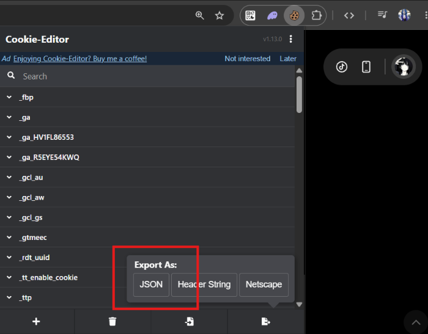

# tiktok-streak

TikTok streak utility for personal and educational use.

The project retrieves streak information from TikTok, displays it in a local Rich interface, and perform supported streak-related actions on accounts you own or are authorized to access.

## Disclaimer

This project is provided for **personal and educational purposes only**.

* This project is **not affiliated with, endorsed by, sponsored by, or officially connected to TikTok or ByteDance Ltd.**
* You are solely responsible for how you use this software and for ensuring that your use complies with applicable laws, regulations, and TikTok's terms and policies.
* The software may interact with TikTok accounts using authenticated sessions. Improper use of automated requests or session credentials may result in restrictions, suspension, or termination of an account.
* **Never share your session credentials or cookies with anyone.** Treat them as sensitive authentication credentials.
* The software is provided **"as is"**, without warranties of any kind. The authors and contributors are not responsible for account restrictions, data loss, service interruptions, or other consequences resulting from its use.
* Use only accounts that you own or have explicit authorization to access.

By using this software, you acknowledge and accept these risks and responsibilities.

Released under the **MIT License**. See [LICENSE](LICENSE).

## stack

- [Python](https://www.python.org) 3.12+
- [httpx](https://www.python-httpx.org)
- [Rich](https://rich.readthedocs.io)
- [Docker](https://www.docker.com) (optional)

## usage

### normal

1. Download / clone the project
2. Install [Python](https://www.python.org/downloads/) (3.12+)
3. Install dependencies:

```bash
pip install -r requirements.txt
```

4. Export TikTok cookies after loggin in with [Cookie-Editor](https://chromewebstore.google.com/detail/cookie-editor/hlkenndednhfkekhgcdicdfddnkalmdm):



5. Copy env and fill cookies:

```bash
cp .env.example .env
```

Paste into `.env` using the exact `TIKTOK_*` labels, or drop a `cookies.json` in the same folder as `main.py` (auto-fills empty `.env` keys).

6. Set `STREAK_MESSAGE` in `.env` if you want

7. `NUDGE_TIME` is the wait between reminder messages, in seconds only. `14400` is 4 hours. Blank uses that same default. Convert hours or minutes with the [time to seconds calculator](https://www.inchcalculator.com/time-to-seconds-calculator/).

8. Run:

```bash
python main.py
```

### docker

```bash
docker build -f dockerfile -t tt .
docker run --env-file .env tt
```

Image runs `python main.py -docker` (plain logs, no Rich).

Same mode locally: `python main.py -docker`  
Rich UI locally: `python main.py`

## Support

Feel free to support me or the project on Ko-fi:

[](https://ko-fi.com/E1E01DZ4X3)
